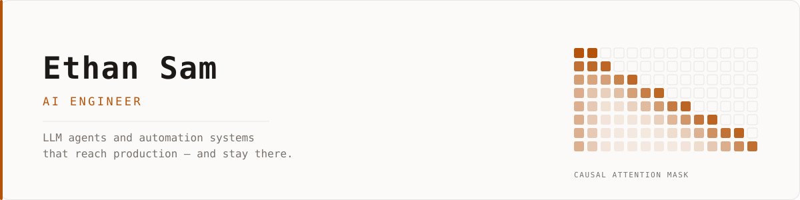

<picture>
  <source media="(prefers-color-scheme: dark)" srcset="assets/banner-dark.svg">
  
</picture>

Hey, I’m Ethan. I build LLM agents and internal tools at MiQ.

## Daily Briefing Buddy

I built an agent that turns Slack threads and calendar events into a morning brief. I sent it as a Slack DM because people already opened Slack first thing. It rolled out across MiQ in **February 2026**. [See a sample run →](https://ethansam.io/#anatomy)

## Account Hub

I co-built the workspace U.S. account managers use to check campaign pacing, spot delivery risks, and file servicing requests. I built the two-way Jira integration so teams could keep working from their existing queues. Within weeks of the U.S. rollout, Account Hub was getting **about 1,600 views a month** and handling **dozens of servicing requests a week**. [Read the case study →](https://ethansam.io/ideas/account-hub)

## A few things I’ve built

**[SwarmTrace](https://github.com/lymnal/swarmtrace-recruiter)** · When an AI agent repeats a claim, can you tell whether it checked first? On our three-person hackathon team, I built the workbench that traces corrections through the original chat, tool output, and screenshots.

**[NeuroScope](https://github.com/lymnal/neuroscope)** · A browser workbench for looking inside GPT-2. Follow its attention head by head and see what changes when you steer it. [Try it →](https://neuroscope-interp.netlify.app)

**[pine-auditor](https://github.com/lymnal/pine-auditor)** · I wrote a tool to catch backtests that assume fills you couldn’t get in real life. Six of the eight public strategies I tested left out both commission and slippage.

**[Couplet](https://lymnal.github.io/couplet/)** · Five word games for exactly two people. I built it for two people I already knew. You can keep playing through a subway ride with no signal, and the game syncs when you’re back above ground. [Source →](https://github.com/lymnal/couplet)

[ethansam.io](https://ethansam.io) · [LinkedIn](https://www.linkedin.com/in/ethansam) · [Email](mailto:esam5556@gmail.com)
