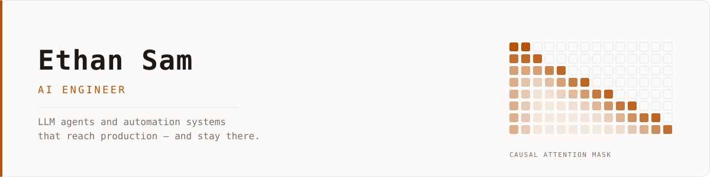

<picture>
  <source media="(prefers-color-scheme: dark)" srcset="assets/banner-dark.svg">
  
</picture>

I build LLM agents and internal tooling at **[MiQ](https://www.wearemiq.com/)**, where the measure
of a system is whether people still use it six months later. Before adtech I did security research
at NYU — CTFs, LLM red-teaming, digital forensics — which is mostly why I now spend my time trying
to falsify my own systems rather than demo them.

**Currently:** mechanistic interpretability of refusal behaviour, and agent harnesses that verify
their own output.

---

### Selected work

**[NeuroScope](https://github.com/lymnal/clearbox_ai)** — mechanistic interpretability for GPT-2, in your browser
GPT-2 runs in the tab over WebGPU; a TransformerLens backend handles logit lens, gradients, steering
and ablation. The bench runs six published refusal-ablation techniques against each other and asks a
sharper question than the papers do — not "did it stop refusing?" but "does it still *represent* the
request as harmful?" — using a probe on the residual stream.
`TypeScript` · `WebGPU` · `TransformerLens`

**[pine-auditor](https://github.com/lymnal/pine-auditor)** — static backtest-integrity audit for Pine Script
TradingView will happily report a 4,000% return on a strategy that trades on future data and pays no
commission. 21 deterministic rules catch that class of defect before it costs money. Run against eight
public strategies by three authors — 1,826 lines the rules were never written against — it produced
**88 findings and no false positives.** Read-only: it never sizes or recommends a trade.
`TypeScript` · `Node`

**[Twogether](https://lymnal.github.io/twogether/)** — four word games for exactly two people · [`source`](https://github.com/lymnal/twogether)
Offline-first PWA, no framework, no build step. ~400 hand-written cards. The hard parts are invisible:
realtime that survives a phone going to sleep, and state that reconciles after a subway ride with no
signal. It has two users and always will — every decision follows from that.
`JavaScript` · `Supabase` · `PWA`

Also built, not public: **NYC Distress Radar** — nightly 0–100 distress scoring for ~857k NYC
properties across nine municipal datasets, with an MCP server for agents. **Anchor** — habit-tracking
iOS app on TestFlight. **Weather Edge** — Kalshi temperature-bracket pricing that grades every thesis
against what actually settled.

---

### At MiQ

- **Daily Briefing Buddy** — an agent that briefs account managers each morning. 93% adoption across
  the US business and 46K+ conversations; the most-used internal AI tool the company has shipped.
- **Account Hub** — servicing workspace for account managers, now the single most-viewed internal app
  at MiQ (~1,600 views/month). No failed writes to date.
- **Ad trafficking automation** — took a manual campaign-setup step off the critical path for ad ops.

---

### Elsewhere

[ethansam.io](https://ethansam.io) · [LinkedIn](https://www.linkedin.com/in/ethansam) · [esam5556@gmail.com](mailto:esam5556@gmail.com)
